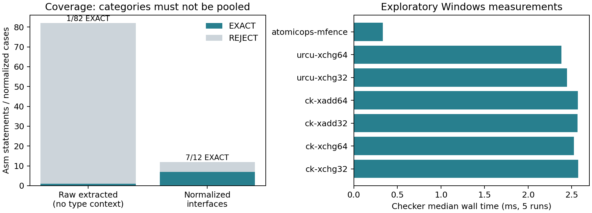

# 阶段 6：实际实验与未完成项

日期：2026-10-20。实验用于检错和测可用性；理论结论只来自06/08的推导。
Windows/WSL探索环境，非正式 BenchExec/cgroup 运行，不给竞赛分数或可靠的 CPU/峰值内存比较。

本文件是初版探索记录。64 项通过属于初版；修订后的新代码/测试尚未运行。
审查修补与用户暂停实验前的有限记录见[修订阶段4](revision/04-implementation-and-review.md)。
下述 82 个是词法抽取结果，未证明是完整 asm 母集或真实 GNU 语义覆盖率。

## 可复现资料

* `experiments/unit-tests.xml`：64项 pytest 测试通过。
* `experiments/checker-results.json/.csv`：原始抽取与规范化接口的全部结果及耗时。
* `experiments/backend-results.json`：14个LLVM后端任务，完整命令、输出及wall time。
* `experiments/litmus-backend-results.json`：4个直接Litmus/CAT任务，含1个明确拒绝。
* `experiments/native-results.json`：Clang编译与GCC原生执行记录。
* `experiments/backend-logs/`：最终处理后的程序和日志。
* `experiments/competition-audit.json`：完整竞赛条目口径及Huawei块级认证。
* `certificates/`：正确样例和删事件/拆RMW变异的认证结果、SMT重放义务。

测试覆盖32/64位、别名、独立读、tied、early-clobber、xchg/xadd/CAS、
成功条件、返回值、compiler barrier元数据、删写、Fence强化/弱化、RMW拆分。
pytest曾因扫描vendor中的WSL符号链接而收集失败；用testpaths=tests修正后，完整64项通过。

## 真实上游片段

版本/URL在 `benchmarks/upstream/sources.json`：

|项目|commit前缀|检查文件|
|---|---|---|
|Concurrency Kit|8f0847cfe57b|include/gcc/x86_64/ck_pr.h|
|libatomic_ops|c7901207f871|src/atomic_ops/sysdeps/gcc/x86.h|
|Userspace RCU|645fdc9b7206|include/urcu/uatomic/x86.h|
|libvsync|dd93f802704c|vatomic/include/vsync/atomic/internal/x86.h|

原始抽取82条：20条解析成功、4条候选提升成功、**1条EXACT**。
没有完整C类型上下文，采用显式64位探索设置；这测的是当前文本入口可用性，
不是这些库的完整语义支持率。拒绝主要来自宏、类型转换、内存表达式、flag outputs、
窄宽度和不支持指令。不能把“能解析20条”写成验证20个程序。

另12个记录来源的规范化接口：12条解析、11条提升、**7条EXACT**。
包含CK xchg/xadd各32/64位、URCU xchg32/64位、libatomic_ops mfence。
这7条只代表少数模板族；不同宽度不算不同算法。
URCU CAS/xadd和atomic_ops xadd因本原型强制显式cc规则拒绝：
这是保守子集限制，**不是认定上游存在接口bug**，还需研究目标编译器的隐式flags约定。
当前libvsync x86专用头只有pause，不能把其他架构的native asm当作x86 RMW覆盖。

宏/类型规范化在 `normalized.json` 逐项说明；没有偷偷给失败案例加cc，
也没有把规范化接口冒充完整原始程序。

## 真实验证器错误复现

`benchmarks/backend-source.c` 的两个线程各执行一次 `lock xaddl` 加1，主线程join后检查x。
在成功创建/回收线程、有效对齐WB地址的契约内，原子性的解析推导给出x=2。
用Clang21从真实GNU C生成LLVM，然后运行未修改Java源码的固定Dat3M版本；
不是仅依靠手写LLVM。

|输入/性质|源的正确结论|原始Dat3M|认证提升后的测试壳|
|---|---|---|---|
|两次xadd，断言x==2|安全|FAIL（错误报警）|PASS|
|两次xadd，断言x==0|不安全|PASS（漏掉源错误）|FAIL|

日志明确警告不能解析asm并使用nondet返回值，处理后程序缺失对x的写。
未使用的局部nondet又被移除；它不能补偿丢失的共享副作用。
GCC原生执行EXPECT=2返回0，EXPECT=0进入失败路径返回42。
该执行只交叉核验复现，不能代替原子性证明。
没有宣称首次发现或已获上游确认，未给维护者发送消息；细节见11文件。

## 弱内存结果与不能计为成功的案例

LLVM并发测试壳断言“不会同时读到0”：

|中间操作|TSO结果|解析预期|
|---|---|---|
|无Fence|FAIL|双零允许|
|空compiler barrier|FAIL|双零允许|
|mfence|PASS|双零形成ob环，禁止|
|保证失败的locked CAS|PASS|失败仍保留RMW排序，禁止|
|把失败CAS改普通读|FAIL|Store→Load排序丢失，允许|

直接X86 Litmus的 `exists` 查询：SB在SC下FAIL（不存在）、TSO下PASS（存在）；
SB+MFENCE在TSO下FAIL（不存在）。Litmus PASS和LLVM安全断言PASS的含义不同。

**SFENCE两个入口都未成功验证其事件语义。** LLVM asm的sfence被警告后忽略，
得到FAIL只是碰巧符合这个WB测试的预期，不能算正确映射。
Litmus语法接受SFENCE，事件工厂却抛异常，结果ERROR。
LLVM adapter已改为保守拒绝SFENCE。块checker对Fsf的匹配不等于后端已经支持它。

## 消融

|配置|实测/结论|
|---|---|
|原始工具|上述非空asm漏报和错误报警可重现|
|只有空asm支持|空屏障已有处理路径，不能修复xadd|
|手工native atomicrmw/CAS映射|是强工程基线；目前复用受限测试壳，未另造独立映射实现|
|无Checker、正确候选|可以得到相同后端结果，Checker不是生成正确候选的必要条件|
|无Checker、删除RMW|错误性质x==0得到PASS|
|无Checker、RMW拆读写|安全性质x==2得到FAIL|
|有Checker、上述两种错误候选|都REJECT，不进入后端|

Dat3M处理后IR的自动反向导入认证尚未实现：
真实缺陷由日志、源码和性质复现定位；Checker拒绝的是对应删事件变异。
不能写成Checker已经自动检出了全部真实后端缺陷。

## 开销

7个成功规范化案例各5次，Checker中位wall time约0.33–2.58ms；
候选提升约0.02–0.06ms；RMW案例Checker约2.4–2.6ms。
后端进程约1.7–2.0s，含WSL/JVM启动；部分设置工作并发，不能计算正式加速比。
小样例无timeout；CPU/峰值内存和OOM没有正式统计。

## SV-COMP口径修正及未运行项

[官方合并表](https://sv-comp.sosy-lab.org/2026/results/results-verified/META_C.Concurrency_deagle.table.html)
有 **3177个任务-性质条目、1058个不同YAML路径**；
Deagle有53条missing、3124条有结果。此前将3124称为完整数据集不准确。
四性质数量为1030、669、725、753，完整清单已保存。

Huawei Demo：52个性质任务、19个源文件，仅1个不同空屏障模板。
19个源文件抽出的模板均认证EXACT，**未据此宣称19个程序或52个性质新增正确结果**。

全量3177项和Huawei整程序未重跑，Deagle适配未实现。
尚无已闭合的整个C宿主与最终后端契约，大规模运行无法补齐此证明缺口。
本轮完成的是Go/No-Go门禁前的探索实验，**不是正式阶段6的全量实验完成**。
