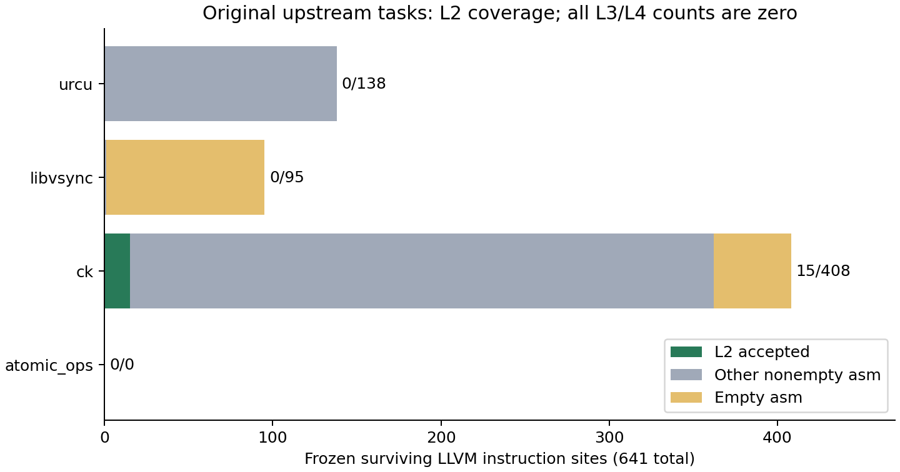
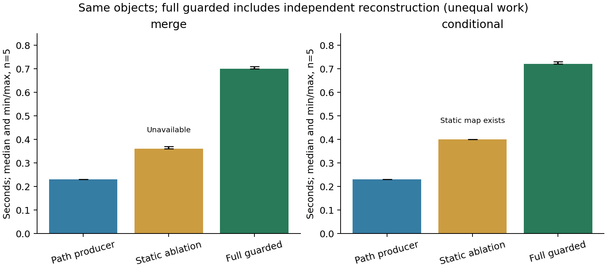

# Gap 4 / Gap 5：真实适用性与系统评测报告

**结论：本轮完成了固定范围的 Linux 原生评测，当前系统尚不足以支撑所主张的 ISSTA
独立工具／系统论文，判定 No-Go。** 真实输入捕获和可复核证据链可以运行，但认证覆盖
仍集中于 CK 的少量局部位置；路径敏感增量只在受控程序上得到验证，没有转化为本轮
第三方程序任务的完整认证能力。这个结论不否定已有受限定理，也不把接入失败解释为
相关算法原则上不能处理该程序。

冻结基线：`b0a788edafbd6c1251c93f49c52e8c4d111c96cb`。分支：
`codex/gap4-gap5-linux-evaluation`。主要数据入口为
[汇总目录](../../experiments/gap45/summary-02/)、
[主证据索引](../../experiments/gap45/published/index.json)和
[补充索引](../../experiments/gap45/published-supplement/index.json)。
复现及可信边界见 [复现说明](02-reproduction-and-boundary.md)。

## 1. 环境、版本及复现门禁

在提供的服务器实际执行了 HTTPS clone 和指定 SHA checkout，建立独立实验分支。
系统是 Ubuntu 22.04.5、Linux 5.15.0-186、32 个逻辑 CPU／16 个物理核、约 122 GiB
内存。实际根盘只有 40 GB，不能声称使用了建议的 500 GB NVMe。服务器身份与硬件、
内核、挂载、包版本、工具版本和原始命令均保留在 environment 证据中；未保存登录密码。

Clang 21.1.8 和 observer 原二进制迁移后散列一致，4,311 个工具／SDK／运行库文件
逐一校验。通过私有 ELF loader 和资源目录解决 Ubuntu 版本差异，没有换编译器或
替换系统 libc。历史没有完整散列的动态库不能据此倒推为“与历史全部逐字节一致”。
Python 3.10.12 符合原 README 的最低版本，区别于原 Windows Python 3.13.12；Z3
5.0.0.0、pytest 9.1.1 固定。Java 21.0.12.1 的发行版构建不同，Maven 3.9.9 保持固定。
系统头文件、库和重建 jar 的差异都明列，没有用新版工具冒充原环境。

Dat3M 固定 `b81ec6c55503e824bb0ddc4ebac6c6f0a63d56d8`，669 个源码构建输入通过
原 Git blob 核验。原始无插桩、只读捕获、受控故障分别构建，原 TSO CAT 不变。
LLVM 链接器也为 21.1.8。四个上游及 Dat3M 共 1,979 个归档内 C/H/Java/CAT 源文件
与原归档字节一致；AO 的 Git tracked diff 另存。生成配置属于原构建流程，不删改客户
端行为。许可证随证据保存。

环境失败没有隐去：partial clone TLS 问题、PyPI 停滞、apt.llvm.org DNS 失败、首次
工具打包路径问题、Clang 子进程 loader 启动问题、Maven 联网停滞，都有日志。Maven
随后使用原依赖缓存离线构建。它们不计入语义缺陷数。

复现门禁结果：

| 检查 | 实际结果 | 保证边界 |
|---|---:|---|
| 原 207 项测试，初次／最终各一轮 | 207 / 207、207 / 207 | 回归，不是普遍证明 |
| 历史 guarded 15 项分类重放 | 全部一致 | 复用原始历史对象，明确标注 |
| 16 项 L1–L4 历史验收，原生重新运行后端 | 全部符合原预期等级与拒绝原因 | 原历史捕获 + 新鲜实际 Q |
| 新鲜受控源码捕获与实际 Q | 2 个开放包含、1 个历史开放差异 | 不是新增真实缺陷 |
| SMT 原始字节重放 | 5,719 条引用，3,007 个不同查询，0 不一致 | 不以无 assumption 的查询替代真实安全查询 |
| 实际 Q 散列、前后对象与同次 run_id | 51 次通过 | 原始／故障／历史回归按目录分别标记 |
| 无 vendor 的独立 checkout 重放 | 6 项结果一致 | 同服务器固定 Python/Z3；非全新虚拟机 |

## 2. 母集、配置、预算与统计单位

采用仓库既有四个项目的固定上游提交，完整 SHA 在注册表中。选择规则在认证前确定：
CK `ck_pr/validate` 的全部 23 个原始目标，加完整双翻译单元 event-counter smoke 客户
端；URCU 的 unit/benchmark uatomic；AO 全部五个原始 check 目标；libvsync 两个
atomic-test 目录中的六个原始 C 测试。其余算法目录、C++、自动生成的类型／操作笛卡尔
测试集从一开始就在研究母集之外，不能据此把本轮称为四个仓库的普查。

37 个任务包括 36 个上游自带测试／可执行调用上下文，以及单列的 1 个完整 CK 客户端。
没有为这些任务新写 harness。已有受控 direct-asm 程序及 CK 自建 harness 只用作回归／
机制对照，**不加入 37 的分母**。AO 的实际 Clang 配置选择了 builtin 路径，没有存活 GNU
asm；五个任务仍然保留，不能把它们改为强制汇编配置以增加成功数。

最初注册表 `registration-02` 已提交为准备阶段 commit `7c3ddf80`。预实验发现两类
命令登记错误后保留原目录并修正：URCU benchmark 原链接不含 common 库四个 TU；AO
两个 Make 命令含 shell 的只读 `test/echo` 源路径展开，不能按普通 argv 截断。修正
只恢复原构建命令，任务选择、性质、资源预算不变。`registration-04` 是最终配置，散列
`5a6111c307fab4f58ee11de8396cd62ec053354f7a8230a7aa8f259d2c2bd34c`。
第一次捕获和局部认证作为预实验保留，最终使用全新 `capture-02/sites-02`。修正不是
按成功率调整算法范围；正式位置清单在本轮对应认证前再次封存。

最终 52 个 TU 捕获成功，来自 44 个不同 C 文件；同一库 TU 被多个程序链接时保留
每个任务的证据，但不计为不同项目。使用原 Make/CMake 配置，libvsync 在首次捕获前
固定为 Debug 以保留上游断言。只增加来源捕获所需 debug 信息及改变输出目标，不
改原 C/asm、线程、循环、回调、系统调用或共享操作。

四种单位不能混用：

- AST 中 7,354 个 TU 内 asm 出现，按物理／宏展开位置归并为 640 个，按配置区分为
  1,692 个。包含未被使用的头文件定义，不能视为动态执行数。
- 实际 LLVM 有 641 个不同的“模块散列 + 指令位置”，其中空 asm 140 个；非空 501 个。
  指令族文本候选 FAA/XCHG/CAS 为 102 个，这只是候选分母，不意味着全部满足接口条件。
- 641 条 LLVM debug inline 链均可完整读取，另记录 18,119 个源调用出现、6,726 个直接
  调用 asm 定义的出现、651 个未解析／间接调用出现。它们是静态提示清单，不是语义
  对应证明。114 个含 asm 的任务／模块／函数组合也不是动态调用实例数。
- 37 个程序任务的完整动态激活分母为 **UNKNOWN，而非 0**。没有根据观察到的 Q 线程
  或有限展开次数宣称覆盖所有源执行。

准备批次最多四个进程，每个 8 个逻辑 CPU、16 GiB cgroup 内存、禁用 swap。正式
对比串行，每个任务固定 CPU 0–7（4 个物理核），完整任务 600 秒，原后端内部 120 秒，
JVM 8 GiB heap，原路径上限 128、源图 64 endpoints 等不变。预算没有按正式成功情况
调整。正式计划为 20 个任务／方法组合各五次，共 100 次；确定性 repeat-major 顺序，
每次读取输入页后启动新进程／JVM，不清系统缓存，也不声称实现了完全冷缓存测量。

## 3. RQ1：真实软件适用性

| 项目 | 原始任务 | LLVM asm | 家族候选 | 空 asm | L1/L2 | 原始实际 Q 完整捕获任务 | L3/L4 |
|---|---:|---:|---:|---:|---:|---:|---:|
| Concurrency Kit | 24 | 408 | 47 | 46 | 15 | 20 | 0 |
| Userspace RCU | 2 | 138 | 55 | 0 | 0 | 1 | 0 |
| libatomic_ops | 5 | 0 | 0 | 0 | 0 | 0 | 0 |
| libvsync | 6 | 95 | 0 | 94 | 0 | 3 | 0 |
| 合计 | **37** | **641** | **102** | **140** | **15** | **24** | **0** |

L2 比例为 15/641（2.34%）；在非空位置上为 15/501（2.99%），在家族候选上为
15/102（14.71%）。后三种分母都保留，不用较好看的比例替代总分母。
15 个位置来自 CK FAA 测试 4 个、FAS 测试 3 个、FAX 测试 2 个、完整 event-counter
客户端 6 个。因此只有四个任务含至少一个 L2 位置，**不等于四个程序得到完整认证**。

626 个位置拒绝原因完整记录：531 个不属于固定支持范围（其中含空 asm）、81 个
GNU 操作数类型／宽度／flag 输出不支持、8 个来源缺失或歧义、6 个 lock 条件不满足。
这些是当前实现范围限制，不是真实转换缺陷。来源或类型不能证明时没有强行绑定。

程序入口方面，ACTC、diagnostics、guarded 都首先拒绝新的通用捕获 receipt；没有
把它伪装成受限旧格式。真实程序另外包含循环、复杂调用、多 asm 定义、运行时对象
及环境行为。因而本轮不能仅凭 schema 拒绝测量各算法“理论处理上限”。静态障碍与
原始 AST/LLVM 全量保留，供后续接入研究；当前可运行版本的程序级接受数就是 0/37。

24 次捕获是**原始 GNU LLVM 导入后的实际 Q**，不是经过 Lifter 后完整认证的目标 Q。
后端保留自身默认界限，捕获成功不证明源语义、激活完整性或无界安全。其余 13 次为：
9 次导出类型不完整（FloatCmpExpr、StateSnapshot、GenericVisibleEvent、Alloc、
FunCallMarker、LoopBound）；URCU unit 的 LLVM parser 错误；AO stack 的循环归一化
不支持；AO malloc 的 8 GiB JVM heap OOM；AO pthreads 的 120 秒超时。全部日志保留。
没有将“缺少快照文件”的表面错误直接当作根因。

完整 CK 客户端保持 2 TU、113 个存活 asm，6 个 L2。其原始实际 Q 因 Alloc 导出不全
拒绝，循环、回调、宿主及动态覆盖仍未闭合。因此仍是完整客户端 0/1，没有删行为。

## 4. RQ2：路径敏感机制的增量

使用本轮重新编译且同次捕获的 merge、conditional 原始对象。source→原始 LLVM、
source→实际优化 LLVM、优化 LLVM→实际 Q、source→Q 分层检查，独立核验重开原始
对象，不接受手工事件映射。

| 同一对象 | guarded 路径机制 | 同提取条件下统一静态映射消融 | 旧方法的实际限制 |
|---|---|---|---|
| merge | 两个激活均开放包含 | `UNIFORM_STATIC_CERTIFICATE_UNAVAILABLE` | diagnostics 源入口要求唯一存活 asm；旧 Q 摘要可产生但不是跨层证书 |
| conditional | 两个激活均开放包含 | `UNIFORM_STATIC_INJECTION_EXISTS` | 旧 Q 解释器拒绝 CondJump；源入口也有受限前提 |

merge 是有效的同对象机制增量：消融共用提取结果，只改变对应量词／路径机制。它不是
通过增加解析白名单、改源码或放松观察实现。conditional 同时说明新算法并非每次都
需要非统一映射。两者仍然是受控程序，不能算作真实第三方覆盖成果。

没有新第三方程序进入完整 guarded 域，故本轮未证明这一增量在真实客户端上的收益。
原始 Dat3M、受检提升器、ACTC/diagnostics、guarded 均保留真实尝试与拒绝。既有提升
入口会运行部分前置检查，不能将其耗时伪称为“完全无 Checker 的提升器”成本；其余
域外任务没有可比的无 Checker 全链结果。报告缺项，不造一个削弱门禁的比较实现。

## 5. RQ3：检测、定位与具体化可靠性

固定八项本轮新运行的受控故障中：错误 guard、遗漏分支、错误操作数、错误返回值四项
均给出 `C-to-imported-LLVM` 的开放差异；只丢 A、只丢 RMW 标签、遗漏实际激活三项
给出 `imported-LLVM-to-actual-Q` 的开放差异。错误 query assumption 不改变 worker
语义，因此开放包含仍成立；独立 query-exclusion gate 在对应 SAT 义务处拒绝。
这是正确分层，不是漏检或后端 PASS 授权。

历史 GNU asm 副作用丢失在新鲜编译／实际后端对象上重现。原始安全相关观察经源图及
目标实际查询排除得到 `CONDITIONAL_CLOSED_ERROR_DIFFERENCE`，仍依赖原 Γ_encode 等
八项 Γ；不是无条件真实机器漏洞证明。强制一个与初始化不相容的开放读取值得到
`UNREACHABLE_OPEN_WITNESS`；不执行目标排除时仅为 `REACHABLE_SOURCE_ERROR_ONLY`。
三类状态保持分离，也都在无工具链的独立 checkout 重放成功。

历史 ITE 问题以及 swap、missing dependency、wrong type、truncated 四种实际导出
故障通过原 16 项等级回归复验；不把 exporter 不完整直接标记为真实源程序缺陷。
独立证书篡改、受控 actual-Q 注入、历史真实回归、未修改上游输入在目录与结果来源中
分开。新确认上游缺陷 **0**；新疑似语义缺陷 **0**。未获得语义对应的真实输入是
UNSUPPORTED／UNKNOWN／导入或资源失败，不是“验证无缺陷”。

7/7 个语义注入被发现、查询注入被专门门禁阻止，仅说明这组固定故障的实现行为。
不能推出普遍检出率、误报率为零或完整程序正确。正常受控转换被接受提供正向对照；
37 个真实任务没有真值 oracle，不能据其拒绝计算误报率。

## 6. RQ4：成本、波动与失败成本

以下为五次预定运行的 GNU time **进程内部 elapsed** 中位数及 min–max；外层 cgroup
启动／等待 wall、user/sys CPU、RSS、全部原始结果另列。外层等待有采样粒度，不能把
它当作亚毫秒算法计时。每一次测量都保留，没有择优取最快或剔除失败。

| 原始捕获任务 | 秒，中位数 [min,max] | CPU 秒，中位数 | 最大单进程 RSS MiB，中位数 |
|---|---:|---:|---:|
| CK FAA | 1.83 [1.83,1.89] | 1.80 | 983.7 |
| 完整 CK event-counter | 4.22 [4.17,4.24] | 4.10 | 1134.4 |
| URCU unit uatomic | 8.22 [8.20,8.23] | 7.89 | 2443.3 |
| AO test_atomic | 6.13 [6.12,6.19] | 6.06 | 2457.7 |
| libvsync dispatcher | 11.03 [10.99,11.06] | 10.98 | 4943.5 |
| libvsync atomicptr_stamped | 3.25 [3.23,3.25] | 3.21 | 1263.1 |

| 受控方法 | merge 秒，中位数 [min,max] | conditional 秒，中位数 [min,max] | 工作／保证 |
|---|---:|---:|---|
| 路径 producer | 0.23 [0.23,0.23] | 0.23 [0.23,0.23] | 同一提取范围的对应求解 |
| 统一静态映射消融 | 0.36 [0.36,0.37] | 0.40 [0.40,0.40] | merge 不可认证；不能算等价成功比较 |
| 完整 guarded | 0.70 [0.70,0.71] | 0.72 [0.72,0.73] | 含原始对象重建和独立证书核验 |
| 旧入口／Q 摘要尝试 | 0.10 [0.10,0.10] | 0.10 [0.10,0.11] | 拒绝／摘要，保证弱于完整 guarded |
| 受检提升及优化 | 0.13 [0.12,0.13] | 0.12 [0.12,0.12] | 含原前置检查，并非纯无 Checker |
| 原始 Dat3M，原始 LLVM | 1.23 [1.18,1.68] | 1.18 [1.13,1.18] | 原后端结果，不是转换正确性 oracle |
| 原始 Dat3M，提升 LLVM | 1.18 [1.18,1.28] | 1.18 [1.13,1.23] | 单独求解成本；与原始 LLVM 不是相同语义保证 |

完整 guarded 的阶段 inclusive 中位数（merge／conditional）分别为：C/AST 入口提取
0.0359/0.0346 秒、LLVM 路径提取 0.0123/0.0102 秒、Q 路径提取 0.0108/0.0160 秒、
关系构造与 SMT 0.3481/0.3641 秒、独立 claim 检查 0.2036/0.2053 秒、所有被计时 SMT
check 0.2002/0.1922 秒。阶段存在嵌套，**不得相加**；solver 时间已经包含在对应和
独立检查中。没有用减法凭空构造“纯候选生成”时间。单独隔离该成本仍是测量缺项。

完整 guarded 每次保存 108／112 个 SMT 文件，证据目录约 731／762 KB（含实现快照，
不是纯证书大小）。纯 certificate.json 与 SMT 的字节数见 `certificate-sizes.csv`。
所有阶段进程记录统一导出为 `all-process-metrics.csv`，嵌套命令不能重复累计为任务
成本。37 个真实任务的 OOM、超时和拒绝成本都保留；正式五次样本不包含被事后删除的
数据。正式测量的短任务不能代表复杂真实客户端性能。

内存度量有明确缺口：内核 5.15 的该 cgroup 接口未提供 aggregate peak，本轮报告
GNU time 的最大**单进程** RSS，不能宣称它是整棵进程树同时占用峰值。16 GiB 上限
确实实施，但它不是峰值测量。冷缓存、随机化顺序、跨机器重复、可信无 Checker
全链性能交集和更大真实成功任务仍缺乏数据；本报告不据此宣称性能胜出。

## 7. 可复核性、可信边界与效度威胁

主包保存 43,485 个原文件引用，原始逻辑大小约 9.26 GB；内容去重后 9,341 个 gzip
对象约 299 MB，最大单对象约 3.73 MB。补充包保留独立 checkout 重放与完整调用上下文
清单。压缩后逐字节可恢复，没有丢弃失败记录；不上传 vendor 二进制或服务器凭据。
源码／工具输入散列、实际 Q、同次 query、SAT/UNSAT、失败原因均可从索引追溯。

外部八项 Γ、源语言风险限制、TSO 模型、程序级门禁没有改变。只读后端 hook 和
来源捕获仍在原可信边界内；哈希不能证明编译器、导入器或求解器语义正确。新通用
捕获适配器增加了实现审阅表面，旧语义核没有扩展。15 份 L2 不被提升为 L3，24 个
捕获 Q 不被提升为动态覆盖，开放 SAT 不被提升为闭合行为差异。

主要效度威胁是有目的的小型原子测试目录选择、单机器、工具链发行版差异、入口格式
限制与算法域限制的混合、缺乏真实程序真值、只在受控程序上实现 guarded 的完整对应、
循环和未知环境未处理，以及整体内存峰值和纯候选生成计时缺失。AO 此配置没有 GNU
asm，使项目数不能等同于获得四个 asm 应用项目的成果。

## 8. Go / No-Go 与后续决策

**当前 ISSTA 独立算法创新：No-Go。当前真实适用性足以支撑独立工具／系统论文：
No-Go。** 本轮提供了可复用的固定版本 Linux 实验基础设施、全分母数据和可靠拒绝
证据，但不是新的语义算法；先前受控路径匹配增量尚无独立真实客户端收益。

可保留的系统价值是来源／真实 Q／实际查询绑定、独立局部证书及分层拒绝；其局部
真实应用覆盖为 CK 四个任务中的 15 个位置。缺少的关键证据是至少若干未经改写的
上游可执行任务能进入同一已证明语义域、自动闭合实际调用覆盖，并在这些对象上优于
旧方法。不能靠增加模板数、复制 worker、强制别的上游配置或隐藏 unsupported 分母
来补齐这一点。

若未来授权继续，应先单独判断：一个非特例的通用真实捕获接入能否在不增加语义
假设的条件下跨过现有入口限制；以及保留原行为的有限真实调用方是否确实落入已证明
域。若只能靠增加完整 C 解释器或删减宿主，本路线仍应停止。当前不建议进入完整
ISSTA 投稿包装，也不提出基于未获得结果的正面贡献定位。本轮在交付、推送和远端
核验后停止，等待审阅。
