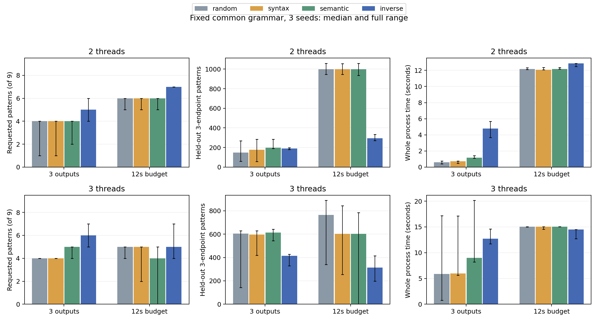

# 关系模式驱动反向程序合成：独立研究验收报告

基线：`4ffe20639ea376485e04a7d545e84776233e80d1`。分支：
`codex/relation-guided-synthesis`。研究日期：2026-10-22。

**结论：正确性与非平凡反向合成通过；指定目标命中有受限、可重复收益，但没有
一般覆盖/总成本优势。独立算法创新及继续开展ISSTA完整实验的判断为 No-Go。**
这不是因为理论基础已有就否定工具价值，而是当前增量仍可解释为标准有界约束
合成、已有FAA引理及完整Oracle核验的组合，且实测收益集中在事先指定的少数模式。
本轮结束后停止，不进入真实Clang/Dat3M语义对照。

## 1. 交付内容与不变边界

* [模型、R_slot算法、量词、双向性与终止证明](01-model-algorithm-proof.md)。
* [原始运行前登记](02-preregistration.md)与[一次统一协议修正](03-protocol-repair.md)。
* [对抗审阅、反例、可信边界与已有方法定位](04-adversarial-review.md)。
* [独立原型及重放命令](../../relation_synthesis/README.md)。
* [修正组全部逐运行数据与CSV](../../experiments/relation-synthesis/summary-03/)、
  [逐尝试记录](../../experiments/relation-synthesis/summary-03/attempts.json)。

新增路径仅为 `relation_synthesis/`、`docs/relation-synthesis/` 和
`experiments/relation-synthesis/`。旧 semantic_testing、E2E-SAFE、L1–L4、ACTC、
guarded、八项Γ及历史证据保持原样。本轮没有编译C、调用真实验证器、搜索软件
缺陷或注入软件故障。所有负例是不可实现的数学关系或无效DSL/证据输入。

## 2. 算法确实做了什么

旧S先产生候选池，对每个程序求完整语义，再贪心选取。新R_slot在一个SMT问题内
同时选择每槽的操作、地址、输入决定的写值、条件控制、完整执行图和目标嵌入。
没有先枚举程序池，没有目标到固定程序的查找表。返回最小core之后，独立组件从
原始DSL恢复全部事件、实际路径及关系，旧B和结构不同的A₀重新求全部合法图。

公开语法是2或3线程、2个对象、每线程3槽；最多两个末槽分支。操作为nop/Load/
Store/FAA32/Fence，写值表为0/1/2/ite(b,1,2)，b完整取false/true；所有读值仍为
完整bv32。每槽的返回变量先初始化0，所有局部和对象终值都观察。读值可控制分支，
不能进入Store值或FAA增量。它不是整个A₀语言，也不是任意C程序。

模式支持R/W/init/A颜色、线程和对象身份、po/rf/co/fr/rmw/mfence/K真/假约束。
省略边是通配，false不是省略；嵌入为单射。多个目标共享语法，分别存在合法执行：
`∃P.∧_f∃G_f embeds(f,G_f)`，不声称一次执行同时满足所有目标或所有执行满足目标。

已实现的剪枝/传播包括静态颜色排除、常量化简、无分支臂规范化，以及可关闭的FAA
直接co前驱冗余约束。后者由旧引理蕴含，不改变可满足域。没有未经证明的图商、
跨程序语义缓存、全局最小程序搜索或最优新增覆盖保证。目标调度只是未覆盖目标的
固定种子顺序；多目标支持是共享语法的精确合取，不是最优多目标覆盖算法。

## 3. 正确性和非平凡性验收

[pilot-02](../../experiments/relation-synthesis/pilot-02/summary.json) 的21项均通过：
9个正关系目标、6个解析上不可实现的负目标、2个分支条件检查、1个多目标查询、
2个传播关闭消融，以及单槽互斥路径的负例。另验收了既有FAA菱形变换，两侧完整
观察集和活跃三端点模式集一致。反例明确说明：仅终态等价不能推出模式等价。

负例包括co环、初始写非最小、对象身份矛盾、双Fence/fr的TSO环、RMW中插入外写、
同一读有两个rf供者、互斥单槽同时产生两个po有序读。每个有界UNSAT保留全部
固定域、请求绑定SMT及重放；另有解析矛盾证明。重放仍依赖Z3，并非已核验的
求解器证明对象。UNKNOWN和超时从未归类为不可实现。

首个读值分支候选实际只走真臂，故没有把“包含if”当作两臂可达。追加的
[branch-both-01](../../experiments/relation-synthesis/branch-both-01/result.json)
由求解器自动选择同一读值FAA分支，在**相同b=false输入**下得到真假两条合法
完整执行；完整集有6图。独立重放从原DSL与路径恢复分支，不相信focus变量。
这是额外正确性边界检查，未修改正式目标集或性能策略。

历史100候选全部通过独立A₀重新求图，再重新提取9项关系，没有依赖旧成功标签。
其目标并集只有6项。以下3项在运行前即登记为新范围内可实现而历史池不可能：

|目标|旧100池缺失的解析理由|新合成及独立证据|
|---|---|---|
|同线程3个FAA写的po/co链|每线程最多2个活跃共享操作|[three_local_faa](../../experiments/relation-synthesis/pilot-02/three_local_faa/)|
|3个不同线程FAA写的co链|只有2个固定用户线程，init不能匹配|[three_thread_faa](../../experiments/relation-synthesis/pilot-02/three_thread_faa/)|
|跨3线程、2对象的rf中继|模式强制3个互异非初始化线程|[relay_three_threads](../../experiments/relation-synthesis/pilot-02/relay_three_threads/)|

原始DSL、模型、公式、见证、全部B图及A₀复核均在各目录。每项的建设性可实现证明
在理论文档中给出，但该程序没有作为生成器输出模板。**旧池缺失不是旧随机算法
不能产生**：正式四种方法使用同一个更大的槽位语法，均允许这些结构。

新增13项及原30项DSL单元检查合计43项，普通Python和`-O`模式均通过。最后审阅
还修正了元数据bool/int混淆和返回语法描述的可变列表别名；原始实验输入均为规范
整数/原始值表，独立重放再次检查其域成员资格。这些是原型实现问题，不是上游缺陷。

## 4. 固定实验分母与成本核算

首次协议在首次求解前以 `06f8935a` 提交。首次正式组formal-01同时有12秒及
24候选上限，快速基线约4秒即耗尽次数；这一组不能作为纯等时间比较，全部保留。
修正协议 `c595eb70` 在修正运行前统一取消time12组的尝试次数上限，未改变目标、
语法、种子、评分或方法。formal-02完整重跑48组合，不挑选最好旧结果。

正式分母为2种线程规模×3种子(11/29/47)×4策略×2预算：
count3（3个不同完整关系特征集，最多60秒/24次），time12（12秒内完成）。每批
语义贪心池为8个同域候选，先完整求解再选；不等于穷尽整个巨大G。语义贪心以
新增目标数为第一关键字、F2为第二关键字，使其与inverse优化相同目标。random/
syntax/semantic共用同种子语法流；syntax仅按语法排序后求Oracle。

所有阶段、失败和证据I/O计入父进程端到端墙钟。每次候选B/首次A/合成上限15秒、
512图；旧性质和特征接口会再次执行默认上限60秒的A核验，因此**15秒不是所有
内部复核的独立硬上限**。父进程统一绝对预算+3秒退出宽限仍强制停止；超出12秒
才完成的结果不得计入time12输出。2GiB监测，Z3同设上限；没有系统级内存配额。
表中的约15秒是包含未完尝试/退出宽限的实际付费时间，不是15秒可接受输出窗口。

机器为Windows11 build26200、i7-13700F（16核/24逻辑线程）、约32GiB RAM；
Python3.13.12、Z3 5.0.0。测量串行执行独立进程，无CPU绑核或冷缓存隔离。重放在
计时结束之后并行进行，不混入正式运行。父进程墙钟包含所有成本，CPU账本为已
记录检查点值；强制结束的尝试末段CPU及尚未返回的查询数无法精确恢复，明确列为
下界，**不能**将已记录CPU或分层时间相加冒充完整总成本。

formal-02共有890次尝试，含879次实际DSL Oracle调用及11次未产生程序的合成
UNSAT/超时。879中871完整且B/A₀一致，8个未完成；另有7个有界UNSAT、4个合成
TIMEOUT。871个完整结果中12个晚于预算，未计入输出。967个可读的生成程序出现
全部通过语法核验，其中含syntax/semantic批次中未执行的候选；不是967个独立
成果。记录到的不同已完成DSL SHA有288个。48组共798个预算内输出出现，按每组
F2+F3集合去重，另有17次关系集重复，未将跨方法/种子重复计作新项目或新缺陷。

已完成结果保存11,244个图出现；预算内所选输出包含8,434个图出现。记录到的
SMT查询下界13,998次；中断调用缺失精确次数保留说明。48进程付费墙钟总和
475.077秒，监测峰值约76.1MiB，formal-02原始材料约423.86MB（十进制）。
这些统计均包含不利结果，而非只选成功任务。

## 5. 同数量和同时间结果

以下为全部3种子的中位数；每个种子、范围、图/观察/路径/查询/内存/证据费用见
[完整JSON/CSV](../../experiments/relation-synthesis/summary-03/)。目标分母固定为9；
2线程域有两项结构上不可实现，未事后从分母删除，故最多7/9。

|线程|预算|策略|输出|目标/9|F2|留出F3|实际秒|
|---|---|---|---:|---:|---:|---:|---:|
|2|count3|random|3|4|45|149|0.611|
|2|count3|syntax|3|4|52|176|0.714|
|2|count3|semantic|3|4|57|198|1.166|
|2|count3|inverse|3|5|51|191|4.799|
|2|time12|random|72|6|100|998|12.170|
|2|time12|syntax|72|6|100|998|12.066|
|2|time12|semantic|71|6|100|998|12.173|
|2|time12|inverse|7|7|63|295|12.877|
|3|count3|random|3|4|72|605|5.859|
|3|count3|syntax|3|4|71|596|5.959|
|3|count3|semantic|3|5|74|614|8.992|
|3|count3|inverse|3|6|60|415|12.702|
|3|time12|random|12|5|83|764|15.050|
|3|time12|syntax|8|5|75|603|15.050|
|3|time12|semantic|8|4|75|603|15.052|
|3|time12|inverse|2|5|55|314|14.493|

2线程time12的inverse对三个基线、全部三个种子均多1–2个指定目标，但F3分别
少640–728个左右。count3中inverse相对random端到端慢约6.3–9.3倍；相对
semantic慢约3.3–4.9倍。故不是无条件更高效：它用更多每程序成本定向得到稀有
结构，放弃大量其他关系模式的吞吐量。

3线程time12的目标数，inverse为7/4/5，random为5/4/5：1胜2平；syntax为
5/2/5，semantic为4/0/5。semantic零输出是完整批次未在截止前求完，不是错误
判定。inverse的F3相对random三个种子都更少。count3的优势也受种子和候选图
规模影响，不能只取seed47的16.7倍相对延迟或seed29较快的一例来归纳。

因此：**指定关系命中在公平等时间下有可重复的受限增量；一般关系覆盖、生成
吞吐、同数量总成本没有优势。** 留出F3与目标相关，且本轮多数F3结果不利，均
没有转换成“泛化更好”或“能发现更多工具错误”的表述。

## 6. 消融与成本原因

传播开关保持同一个目标、语法和种子；它是原CAT的逻辑后果，接受域不变。
预登记的两个小型消融结果如下（全部正确核验）：

|目标|传播|编码秒|SMT秒|生成程序完整图数|预实验总秒（含重放）|
|---|---|---:|---:|---:|---:|
|3线程FAA|开|0.394|0.286|24|4.503|
|3线程FAA|关|0.353|0.275|306|21.960|
|SB|开|0.211|0.183|14|2.001|
|SB|关|0.158|0.158|12|1.521|

不能据第一项声称传播普遍加速：两种公式的求解器选择了不同的合法程序，完整
图规模不同，且只有一个种子。第二项目标关闭传播反而更快。证明支持“不会删解”，
实验仅揭示求解器见证选择会把成本转移到后续Oracle，而不证明稳定速度收益。

真实瓶颈包括：直接编码/SMT及大公式序列化的固定费用；任意额外操作形成的co/rf
组合爆炸；全部路径/图与三端点规范化、重复独立检查的费用；选中程序并未最小化
语义规模；预定目标很少而F2/F3区别能力有限。上述费用均保留在总时钟内。因
没有实现最优规模/核验成本目标，本轮不补做无限参数调整来寻求正结果。

## 7. 实现—证明对应及独立重放

|义务|新增实现|独立事实/边界|
|---|---|---|
|固定语法/类型/完整观察|grammar.decode、check.grammar_membership|从原DSL恢复，不信choices.json|
|路径与参数正确|encode.Execution条件端点|旧witness解释全部实际语句，B/A遍历全部路径|
|统一rf/co/fr、RMW、Fence、TSO|encode.Execution|旧具体图检查+显式A₀，非各线程各选世界|
|存在模式及真/假边|SMT单射变量|patterns.matches从完整图重新搜索|
|多目标共用程序|Synthesis语法共享|逐请求core全部核验，不互换量词|
|精确图集/观察预期|复用B、A₀、expectations|完整集不一致/资源耗尽不计成功|
|公式与请求绑定|check.replay|重建断言，严格交换律规范化；UNSAT依赖Z3|
|截止与失败不消失|benchmark父进程/账本|部分CPU/查询仅下界；晚结果不进输出|

正式原始证据逐项重放见
[replay-formal-01.json](../../experiments/relation-synthesis/replay-formal-01.json)，
预实验见[replay-pilot-01.json](../../experiments/relation-synthesis/replay-pilot-01.json)，
双臂见[replay-branch-01.json](../../experiments/relation-synthesis/replay-branch-01.json)。
重放从原DSL检查图全集、观察、目标、完整特征及每路径SMT和阻断义务，不是再次
读一遍成功字符串。重放费用单列，不伪装为正式生成时间的一部分。
正式重放931项（60项合成记录、871项完整Oracle结果）全部VERIFIED，0失败，
耗时486.431秒；预实验重放37项全部VERIFIED，耗时37.384秒。读值双臂额外重放
亦VERIFIED。它们并行发生在正式计时结束之后；重放时间不用于方法加速比较。

## 8. 失败、效度威胁与最终判定

保留pilot-01的SMT文本绑定失败、budget-pilot-01的工作目录启动失败、正式第一组
协议缺陷及所有超时。SMT重放失败修正为有证明依据的交换律结构比较，未忽略字段。
读分支单臂退化单列并补充同输入双臂检查。没有把这些原型问题计为任何真实缺陷。

限制：只有一个公开槽位骨架、固定初值/表达式表、9个指定目标、3个种子；完整
语义贪心是8候选批次而非全G最优；元数据/DSL/Python、具体检查器及A实现仍受
信任，数学模型双向性不等于程序机器码已验证；没有FIFO/CAT一般等价；未监控的
末段CPU只能给下界。硬时限有退出宽限，峰值是Windows进程监测值。图/候选高度
相关，F3不是缺陷泛化指标。所有结果仅针对该DSL和固定CAT。

|验收层|判断|理由|
|---|---|---|
|正确性|受限PASS|联合完整图编码，全部确认结果有独立A₀/B与原DSL见证，负目标可靠拒绝|
|非平凡合成|PASS|自动得到历史池缺失的3类预登记关系，四方法新语法相同，无模板查表|
|指定目标命中有效性|受限PASS|2线程等时间3/3种子均有增量；3线程部分胜/平，成本完整计入|
|一般覆盖效率或总成本提升|No-Go|F3/吞吐明显落后，同数量通常更慢，三线程核验经常超预算|
|独立算法创新/ISSTA研究价值GO|No-Go / NOT_ESTABLISHED|联合有界SMT、已有前驱引理与核验链尚未超出标准机制组合|
|进入真实工具缺陷测试|本轮不进入|无任何实际工具证据，按要求停下等待独立审阅|

保留下来的价值是一个有明确有限域、可复核目标见证及成本账本的反向生成原型。
最值得进一步审查的缺口是如何在不先求完整池的情况下同时控制后续核验复杂度、
是否存在有证明的分解机制，以及目标模式对真实工具语义处理是否有预测价值。
这些是未解决问题，不是本轮已经取得的新算法或下一阶段自动授权。
